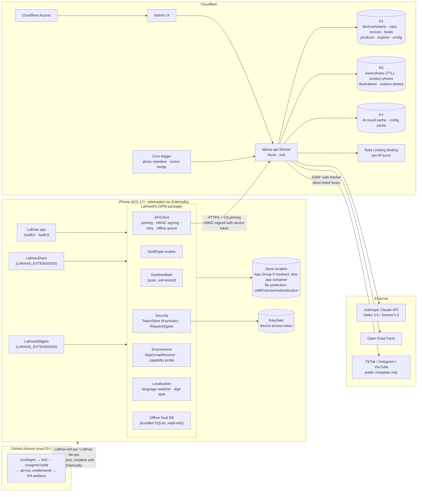
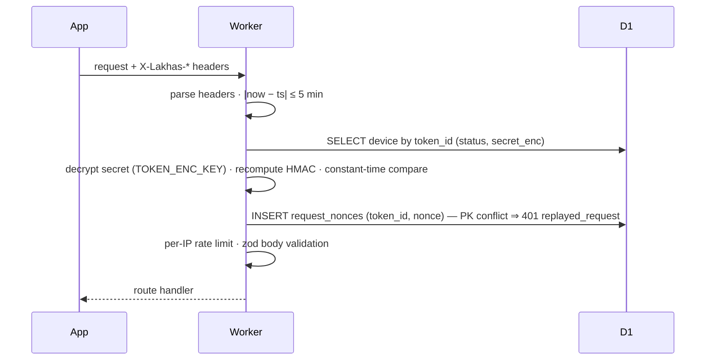

# لخّص (Lakhas) — Architecture

Status: **Approved plan, revised for personal sideloading** · Last updated: 2026-10-11

This document covers the component layout, the data models (SwiftData on device, D1 on the server), the API contract, and the key request flows. Decisions are recorded in [`decisions.md`](decisions.md). Sideloading constraints are in [`sideloading.md`](sideloading.md).

---

## 1. Component diagram



### Responsibilities

| Component | Responsibility |
|---|---|
| **Lakhas (app)** | All screens, navigation, camera/barcode, token entry, local notifications, backup export/import. |
| **LakhasKit** | Everything shared with extensions: models, math, API client, signing, store location, localization, and theme tokens. |
| **LakhasWidgets** (optional) | Reads the SwiftData store from the resolved App Group. Interactive actions (`+250 ml`, `set done`) run AppIntents that write to the same store. Shows a placeholder when no shared container exists. Never calls the network. |
| **LakhasShare** (optional) | Receives a URL or image. With an App Group, it queues the item for the app; without one, it copies the link to the clipboard. Never calls the network. |
| **Worker** | Token auth + HMAC verification, cost caps, AI orchestration, food/product lookup, admin. Holds every secret. |
| **D1** | Source of truth for server state, including cap counters and nonces (ADR-004, ADR-013). |
| **KV** | AI result cache keyed by input hash; config read-through cache. |
| **R2** | Binary objects; meal photos carry `expires_at` and are purged by cron. |

---

## 2. Repository layout

```
/ios
  project.yml                 XcodeGen spec; extensions included when LAKHAS_EXTENSIONS=1
  Lakhas/                     app target (App/, Features/<Feature>/, Resources/)
  LakhasWidgets/
  LakhasShare/
  LakhasKit/                  local SPM package
    Sources/NutritionMath/    pure Swift, Foundation only
    Sources/LakhasKit/        models, API client, security, environment, l10n, theme
    Tests/
  Config/                     xcconfigs, entitlements, Info.plist templates
  scripts/                    build-ipa.sh, check-strings.py
/backend
  src/                        Hono app: routes/, services/, ai/, db/, lib/
  prompts/                    versioned system prompts
  migrations/                 D1 SQL migrations
  seed/                       USDA subset, arabic_dishes.csv, exercises
  test/                       vitest (workers pool); mocked Anthropic client
  wrangler.toml
/shared
  openapi.yaml                API contract
  schemas/                    JSON Schemas for AI outputs
  test-vectors/               signing.json (shared by Swift + TS tests)
/admin                        small static UI bundled into the Worker
/docs                         architecture, design, decisions, sideloading, runbooks
.github/workflows/            ios.yml, backend.yml
CLAUDE.md
```

---

## 3. iOS data model (SwiftData)

All `@Model` types live in `LakhasKit`. The store location comes from `AppGroupResolver` (ADR-014): App Group container if resolved, else the app's Application Support. File protection `completeUntilFirstUserAuthentication` is set on the store files. Logs keep **snapshots** of names and per-100g values (ADR-010).

### 3.1 Profile & goals
```swift
@Model UserProfile            // singleton
  sex: Sex                    // .male / .female
  birthYear: Int
  heightCm: Double
  weightKg: Double            // latest; history in WeightEntry
  activity: ActivityLevel     // .sedentary .light .active .veryActive
  goal: Goal                  // .lose .maintain .gain
  paceKgPerWeek: Double       // lose 0.25–1.0, gain 0.25–0.5, maintain 0 (ADR-011)
  onboardedAt: Date

@Model GoalOverride           // "My Goals"; nil = computed
  calories: Int?  proteinG: Int?  carbsG: Int?  fatG: Int?  waterMl: Int?
  goalWeightKg: Double?       // overrides the BMI-25 reference weight for protein
```
Non-sensitive preferences (language, units, digit style, appearance, reminder toggles, last backup date) go in `UserDefaults` (App Group suite when resolved). The token is **only** in the Keychain.

### 3.2 Food logging
```swift
@Model Meal
  id: UUID, dayKey: String, loggedAt: Date
  mealType: MealType          // .breakfast .lunch .dinner .snack
  source: LogSource           // .photo .text .barcode .plate .saved .explore .recipe
  sortIndex: Int
  photoThumbPath: String?
  remoteAnalysisId: String?   // for "Correct with AI"
  @Relationship(deleteRule: .cascade) items: [MealItem]

@Model MealItem
  id: UUID, nameAr: String, nameEn: String, grams: Double
  kcalPer100, proteinPer100, carbsPer100, fatPer100: Double
  valueSource: ValueSource    // .db .ai .product .user
  foodDbId: String?, barcode: String?, confidence: Double?
  // totals are computed: grams × per100 / 100

@Model SavedMeal              // "ready meals"; items have MealItem's shape
@Model CachedProduct          // barcode (unique), names, brand, servingG, per-100g, status, illustrationPath
```

### 3.3 Recipes & Explore
```swift
@Model Recipe
  id, titleAr, titleEn, servings, stepsLanguage, steps: [String]
  origin: .link | .screenshot, sourceURL?, creatorHandle?, platform?
  illustrationPath?
  @Relationship(deleteRule: .cascade) ingredients: [RecipeIngredient]

@Model RecipeIngredient       nameAr, nameEn, grams, per-100g, valueSource, foodDbId?, sortIndex
@Model SavedExploreDish       remoteId (unique), snapshot, myVote?, savedAt
@Model PendingImport          id, kind (.link/.image), payloadPath, createdAt   // from share extension
```

### 3.4 Water, weight
```swift
@Model WaterEntry   id, dayKey, at, ml: Int
@Model WeightEntry  id, at, kg: Double
```

### 3.5 Workouts
```swift
@Model Exercise               id (dataset slug), nameAr, nameEn, nameArMachineTranslated,
                              primaryMuscles, secondaryMuscles, equipment, level, imageNames, alternativeIds
@Model WorkoutProgram         id, createdAt, isActive, daysPerWeek, equipment, experience, split, days
@Model ProgramDay             id, index, nameKey, exercises: [ProgramExercise]
@Model ProgramExercise        id, exerciseId, order, targetSets, repMin, repMax, restSec
@Model WorkoutSession         id, startedAt, finishedAt?, programId: UUID?, programDayName (snapshot), sets
@Model SetLog                 id, exerciseId, exerciseNameAr/En (snapshot), setIndex, reps, weightKg, at
```

### 3.6 Infrastructure
```swift
@Model PendingWrite           // offline queue for non-AI writes (votes)
  id, method, path, body: Data, createdAt, attempts, nextAttemptAt
```
**Backup (ADR-016):** `BackupService` serializes every model into a versioned JSON document (`schemaVersion`, `exportedAt`, arrays per model) plus a `photos/` folder, zipped. Import merges by UUID and skips existing records.

### 3.7 Offline food DB
A read-only SQLite file (`FoodDB.sqlite`, FTS5 over names and aliases) generated from the D1 seed at build time and opened with the SQLite C API (ADR-009).

---

## 4. Server data model (D1)

```sql
-- devices & auth (ADR-013)
devices(token_id TEXT PK,             -- public part of the token
        label TEXT,                   -- "Khaled's iPhone"
        secret_enc BLOB, secret_iv BLOB,  -- AES-GCM under TOKEN_ENC_KEY
        status TEXT CHECK(status IN ('active','revoked')),
        created_at, activated_at NULL, last_seen_at NULL, revoked_at NULL,
        tz TEXT NULL, tz_changed_at NULL,
        lang TEXT NULL,
        improve_opt_in INTEGER DEFAULT 0,
        cap_overrides TEXT NULL)      -- JSON, per-device caps (ADR-015)
request_nonces(token_id, nonce, created_at, PRIMARY KEY(token_id, nonce))  -- purged after 10 min

-- cost caps (ADR-004/015)
cap_events(device_id, day_key TEXT, cap_type TEXT, input_hash TEXT,
           status TEXT CHECK(status IN ('reserved','committed')), created_at,
           PRIMARY KEY(device_id, day_key, cap_type, input_hash))
config(key TEXT PK, value TEXT /* JSON */, updated_at)  -- caps, model names, retention

-- food data
foods(id TEXT PK, name_en, name_ar, name_ar_source /* human | machine_translated */,
      aliases_en, aliases_ar, kcal_100, protein_100, carbs_100, fat_100, fiber_100 NULL,
      portions TEXT /* JSON */, source /* usda | curated_estimate | curated_verified */, source_ref, notes)
foods_fts  -- FTS5 over names/aliases (verify D1 FTS5 support in Phase 4)
products(barcode PK, name_ar, name_en, brand, serving_g, kcal_100, protein_100, carbs_100, fat_100,
         status /* approved | pending_review | rejected */, origin /* off | contributed */,
         contributor_device_id NULL, label_image_key NULL, front_image_key NULL,
         illustration_key NULL, created_at, reviewed_at NULL)
portion_corrections(food_key, predicted_g, corrected_g, created_at)  -- anonymized

-- explore
explore_dishes(id PK, title_ar, title_en, desc_ar, desc_en, photo_key, goal_tag, meal_types,
               ingredients TEXT, kcal, protein, carbs, fat, servings, published, created_at,
               up_count, down_count)
explore_votes(dish_id, device_id, vote CHECK(vote IN (-1,1)), created_at, PRIMARY KEY(dish_id, device_id))

-- storage & ops
uploads(r2_key PK, device_id, kind, created_at, expires_at NULL, keep INTEGER)
abuse_events(id PK, device_id NULL, ip_hash, kind, detail, created_at)
admin_audit(id PK, actor, action, target, created_at)
```

**Deletion (`DELETE /v1/device`):** removes the device's `cap_events`, nonces, votes (with counts adjusted), uploads and their R2 objects, unreviewed contributions, and KV cache entries. Then it marks the token `revoked` and wipes its secret and settings. Approved contributed products stay, with `contributor_device_id` nulled. The device row itself is kept only as a revoked tombstone, so the token can't be reused.

---

## 5. API contract (summary; full spec in `/shared/openapi.yaml`)

### 5.1 Request headers
| Header | Purpose |
|---|---|
| `X-Lakhas-Token-Id` | public token ID |
| `X-Lakhas-Timestamp` | Unix ms; ±5 min skew allowed |
| `X-Lakhas-Nonce` | 16 random bytes, base64url; single use per token |
| `X-Lakhas-Signature` | base64url HMAC-SHA256 over the canonical string (ADR-013) |
| `X-App-Lang` | `ar` \| `en`; drives AI output language and error text |
| `X-Timezone` | IANA tz; used for `day_key` (clamped) |
| `X-App-Version` | build number |

Canonical string: `"LK1\n" + METHOD + "\n" + path[?query] + "\n" + timestamp + "\n" + nonce + "\n" + lowercase-hex(SHA256(body))`.

### 5.2 Error envelope
```json
{ "error": { "code": "cap_reached", "retryable": false,
             "message": "<localized per X-App-Lang>", "details": { "cap": "photo", "resetsAt": "…" } } }
```
Codes: `invalid_request`, `unauthorized`, `token_revoked`, `bad_signature`, `stale_request`, `replayed_request`, `cap_reached`, `daily_cap`, `rate_limited`, `ai_unavailable`, `ai_invalid_output`, `not_found`, `unsupported_url`, `fetch_failed`, `payload_too_large`.

### 5.3 Endpoints
| Endpoint | Request | Response | Cap |
|---|---|---|---|
| `GET /health` | — | `{ok, version}` | — (no auth) |
| `GET /v1/device` | — | `{label, caps, serverTime}` | — |
| `POST /v1/analyze/photo` | multipart: `image` (≤ 2 MB JPEG), `leftover?`, `mealHint?`, `advanced?` | `AnalysisResult` | `photo` |
| `POST /v1/analyze/text` | `{text ≤ 500, advanced?}` | `AnalysisResult` | `text` |
| `POST /v1/analyze/correct` | `{analysisId, correction ≤ 300}` | `AnalysisResult` | `correct` |
| `GET /v1/barcode/:code` | — | `Product` or `404` | `barcode` (only when found) |
| `POST /v1/products/contribute` | multipart: `barcode`, `label`, `front` | `Product` (`pending_review`) | `barcode` |
| `POST /v1/recipes/import-link` | `{url}` | `Recipe` | `recipe` |
| `POST /v1/recipes/import-image` | multipart: `image` | `Recipe` | `recipe` |
| `GET /v1/foods/search?q=&lang=` | — | `{items: Food[]}` | — |
| `GET /v1/explore?goal=&meal=&sort=newest\|top&cursor=` | — | `{items, next}` | — |
| `POST /v1/explore/:id/vote` | `{vote: 1\|-1}` | `{up, down, mine}` | — |
| `GET /v1/quota` | — | `{day, resetsAt, caps: {photo:{used,limit},…}}` | — |
| `DELETE /v1/device` | — | `204` | — |
| `/admin/*` | Cloudflare Access (ADR-007) | HTML + JSON | — |

Admin JSON routes (under Access): `POST /admin/api/devices` (create; returns the token once + QR SVG), `GET /admin/api/devices`, `PATCH /admin/api/devices/:id` (label, caps), `POST /admin/api/devices/:id/revoke`, plus the Explore, review-queue and config routes.

### 5.4 Core shapes
```ts
AnalysisResult = {
  analysisId: string, model: "standard" | "advanced", promptVersion: string,
  items: Array<{ id, nameAr, nameEn, grams, confidence /*0..1*/,
                 per100: { kcal, protein, carbs, fat },
                 foodDbId: string | null, valueSource: "db" | "ai", leftoverGrams?: number }>,
  totals: { kcal, protein, carbs, fat },   // computed by server code; client recomputes
  notes?: string
}
Recipe  = { title: {ar, en}, servings, ingredients: [{nameAr, nameEn, grams, per100, foodDbId?}],
            steps: string[], perServing, source: {url?, platform?, creatorHandle?}, illustrationUrl? }
Product = { barcode, nameAr, nameEn, brand, servingG, per100, status, origin, illustrationUrl?, attribution? }
```

---

## 6. Key flows

### 6.1 Device activation
1. The admin creates a device in `/admin` and gets `lk1_<id>_<secret>` once, plus a QR code.
2. First launch → token screen → paste, or scan with VisionKit (QR).
3. The app signs `GET /v1/device` with the token. On `200` it stores the token in the Keychain and continues to onboarding. On `401` it shows "This token isn't valid or was revoked".
4. Any later `401 token_revoked` clears the Keychain item and returns to the token screen. Local data is kept.

### 6.2 Request verification (Worker middleware)


### 6.3 Photo analysis
1. **On device:** downscale to ≤ 1568px, re-encode JPEG 0.8 with metadata stripped.
2. **Auth:** signed `POST /v1/analyze/photo` → middleware (§6.2).
3. **Dedupe:** `hash = SHA256(image bytes [+ leftover bytes])`. On a KV hit for `result:{device}:{day}:{hash}`, return the cached result; it isn't counted.
4. **Reserve** a cap slot in D1. This is atomic and fails with `cap_reached` / `daily_cap`.
5. **Candidates:** top-N candidate foods from D1, by fuzzy name match.
6. **Model call:** Claude with structured output (prompt version, language, candidates, image).
7. **Post-process:**
   - validate with zod (one retry on failure);
   - **DB override:** a candidate match with confidence ≥ `config.db_override_min_confidence` (0.6) takes the D1 per-100g values;
   - compute totals as `grams × per100`;
   - leftovers: eaten grams = `max(0, grams − leftoverGrams)`.
8. **Finish:** commit the cap event, store the result in KV (TTL 36h), and respond. On any failure the reservation is released.

### 6.4 Cost-cap algorithm
- `day_key` = the current date in the device's stored tz. A different `X-Timezone` within 24h of the last change is ignored (clamped) and logged.
- **Reserve:** `INSERT INTO cap_events … SELECT … WHERE (count for type today) < :limit AND (count all types today) < :global`. Zero rows means rejected.
- Limits come from `devices.cap_overrides`, falling back to the `config` defaults: photo 10, recipe 5, text 5, barcode 10, correct 10, global 40.
- A stale `reserved` row (> 5 min) is removed by cron.

### 6.5 Recipe link import
- **Allowed hosts:** `tiktok.com`, `vm.tiktok.com`, `instagram.com`, `youtube.com`, `youtu.be`, `m.youtube.com`.
- **YouTube:** Data API (title + description).
- **TikTok:** public oEmbed.
- **Instagram:** official oEmbed with the Meta app token. If that fails, the user is asked to use screenshot import.
- **Fetcher:** the SSRF-safe fetcher follows redirects manually (max 3) and re-checks each host. It rejects IP literals and private ranges, applies a 5s timeout, caps the body at 1 MB, and accepts only HTML/JSON.

### 6.6 Illustrations
Haiku produces the SVG. An allow-list sanitizer passes only these elements: `svg g path circle ellipse rect line polyline polygon linearGradient radialGradient stop defs`. Only geometry and paint attributes are kept, and colors must come from the fixed palette. Rejected:
- `href`, `url(` and event handlers;
- `<text>`, `<image>` and `<foreignObject>`;
- anything over 20 KB.

The sanitized SVG is rasterized to a 512px PNG with resvg-wasm. Both files go to R2 (ADR-008).

### 6.7 Store location (ADR-014)
```
AppGroupResolver.resolve():
  1. groups = entitlements["com.apple.security.application-groups"] from embedded.mobileprovision
  2. for id in groups + [compiled default]: if FileManager.containerURL(forSecurityApplicationGroupIdentifier: id) is writable → use it
  3. else → app's Application Support (widgets then show a placeholder)
```
The resolved ID is cached per launch and shown in Settings → Sideloading status.

---

## 7. AI integration

- **SDK:** `@anthropic-ai/sdk` in `backend/src/ai/` only. Model IDs come from `config`: `MODEL_STANDARD = claude-haiku-5-5`, `MODEL_ADVANCED = claude-sonnet-5-5`.
- **Structured output (ADR-002):** `client.messages.parse({ output_config: { format: zodOutputFormat(Schema) } })`; zod validation; one retry; `stop_reason` checked first.
- **Model routing:** standard for scans, labels, recipes and SVGs. Advanced for corrections and for scans where the user switched on "advanced analysis".
- **Effort:** `low` on standard routes, `medium` on advanced; tuned in Phase 4 against a small eval set.
- **Prompt caching:** static system prompt carries `cache_control`; volatile parts (language, candidates, user content) follow the breakpoint. Verified via `usage.cache_read_input_tokens` in logs.
- **Injection resistance:** user content is wrapped in `<user_content>` tags and the system prompt says it's data. Output is schema-constrained and reviewed by the user before saving.
- **Prompts:** `backend/prompts/{photo,text,correct,label,recipe,illustration}.v1.md`. The version is returned in `AnalysisResult.promptVersion`.

---

## 8. Security summary

| Control | Implementation |
|---|---|
| No secrets in app | Worker secrets only; CI greps the IPA for key patterns |
| TLS + pinning | ATS default; CA SPKI pinning with backup pins (ADR-005) |
| Device auth | Admin-issued token, Keychain storage, HMAC per request, nonce + timestamp replay protection, revocation (ADR-013) |
| Data at rest (device) | Per-file `completeUntilFirstUserAuthentication`; token only in Keychain |
| Data at rest (server) | Platform encryption; token secrets additionally AES-GCM encrypted; meal photos expire (30 days) |
| Photo hygiene | Re-encode with metadata removed; ≤ 1568px; JPEG 0.8 |
| Abuse / cost | Per-type + global daily caps (D1), per-IP burst limit, `abuse_events` |
| Input validation | zod on every route, per-route body limits, SSRF-safe fetcher |
| No tracking | No SDKs; accurate privacy manifest |
| Deletion | §4 deletion scope |
| Logging | Structured JSON; token ID HMAC-hashed in logs; no bodies, no clear IPs |

---

## 9. Phase 0 questions — all resolved

All questions are closed. The resolutions are recorded in ADR-002, ADR-005, ADR-007 and ADR-011 to ADR-018. Questions about attestation, subscriptions, referrals and support were dropped along with those features (ADR-015).
