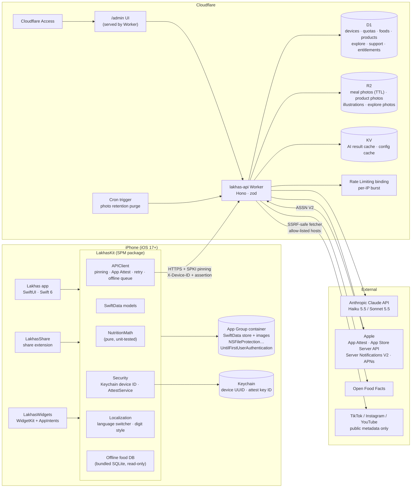
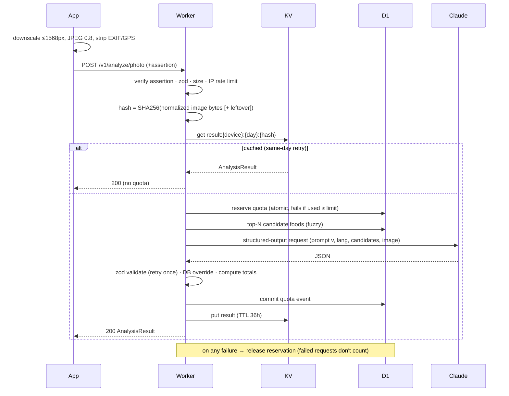

# لخّص (Lakhas) — Architecture

Status: **Draft for approval (Phase 0)** · Last updated: 2026-10-11

This document covers the component layout, the data models (SwiftData on device, D1 on the server), the API contract, and the key request flows. Proposed decisions that deviate from or refine `PROJECT_PROMPT.md` are marked **⚠ Proposed** and also listed in [`decisions.md`](decisions.md). Open questions are in §9.

---

## 1. Component diagram



### Responsibilities

| Component | Responsibility |
|---|---|
| **Lakhas (app)** | All screens, navigation, camera/barcode, StoreKit purchase UI, local notifications. |
| **LakhasKit** | Everything shared with extensions: models, math, API client, security, localization, and theme tokens. Extensions never duplicate logic. |
| **LakhasWidgets** | Read-only SwiftData access through the App Group. Interactive actions (`+250 ml`, `set done`) run AppIntents that write to the same store and reload timelines. |
| **LakhasShare** | Takes a URL or image from TikTok/Instagram/YouTube/Photos and queues a recipe import. The share extension hands off to the app; it doesn't call the AI directly (memory limits, and the app owns App Attest). |
| **Worker** | Auth (device ID + App Attest), quotas, AI orchestration, food/product lookup, subscriptions, support, admin. Holds every secret. |
| **D1** | Source of truth for server-side state. Quota counters live here, not in KV (see ADR-004). |
| **KV** | AI result cache keyed by input hash, and a read-through cache for remote config. Both are fine with eventual consistency. |
| **R2** | Binary objects. Meal photos carry `expires_at` metadata, and a daily cron purges them. |

---

## 2. Repository layout

```
/ios
  project.yml                 XcodeGen spec (Lakhas, LakhasWidgets, LakhasShare, tests)
  Lakhas/                     app target (Features/<Feature>/…, App/, Resources/)
  LakhasWidgets/
  LakhasShare/
  LakhasKit/                  local SPM package
    Sources/NutritionMath/    pure Swift, no imports beyond Foundation
    Sources/LakhasKit/        models, API client, security, l10n, theme
    Tests/
  Resources/Localizable.xcstrings, PrivacyInfo.xcprivacy, FoodDB.sqlite
/backend
  src/                        Hono app: routes/, services/, ai/, db/, lib/
  prompts/                    versioned system prompts (photo.v1.md, text.v1.md, …)
  migrations/                 D1 SQL migrations
  seed/                       USDA subset, arabic_dishes.csv, exercises
  test/                       vitest + miniflare; mocked Anthropic client
  wrangler.toml
/shared
  openapi.yaml                API contract (source of truth for both clients)
  schemas/                    JSON Schemas for AI outputs (also used by zod)
/admin                        small static UI (vanilla TS or Preact), bundled into the Worker
/docs                         architecture.md, design.md, decisions.md, runbooks/
CLAUDE.md
```

---

## 3. iOS data model (SwiftData)

All `@Model` types live in `LakhasKit`. The store sits at `AppGroup/Library/Application Support/Lakhas.store` with file protection `completeUntilFirstUserAuthentication`. **Everything is keyed by stable UUIDs.** Logs keep a *snapshot* of names and per-100g values, so editing a food, program or recipe never changes history.

### 3.1 Profile & goals
```swift
@Model UserProfile            // singleton
  sex: Sex                    // .male / .female
  birthYear: Int              // age derived; avoids stale "age"
  heightCm: Double
  weightKg: Double            // latest; history in WeightEntry
  activity: ActivityLevel     // .sedentary .light .active .veryActive
  goal: Goal                  // .lose .maintain .gain
  paceKgPerWeek: Double       // lose 0.25–1.0, gain 0.25–0.5, maintain 0 (ADR-011)
  goalWeightKg: Double?       // optional (My Goals); default ref = BMI-25 weight (ADR-011)
  referralCode: String?
  onboardedAt: Date

@Model GoalOverride           // "My Goals"; nil field = use computed
  calories: Int?  proteinG: Int?  carbsG: Int?  fatG: Int?  waterMl: Int?
```
Non-sensitive preferences go in App Group `UserDefaults`: language, units, digit style, appearance and reminder toggles. **Nothing sensitive goes in UserDefaults** (§3.5 of the brief).

### 3.2 Food logging
```swift
@Model Meal
  id: UUID
  dayKey: String              // "2026-10-11" in the user's local calendar at log time
  loggedAt: Date
  mealType: MealType          // .breakfast .lunch .dinner .snack
  source: LogSource           // .photo .text .barcode .plate .saved .explore .recipe
  sortIndex: Int              // order within group (drag & drop)
  photoThumbPath: String?     // relative to App Group, protected
  remoteAnalysisId: String?   // for "Correct with AI"
  @Relationship(deleteRule: .cascade) items: [MealItem]

@Model MealItem
  id: UUID
  nameAr: String  nameEn: String
  grams: Double
  kcalPer100: Double  proteinPer100: Double  carbsPer100: Double  fatPer100: Double
  valueSource: ValueSource    // .db .ai .product .user
  foodDbId: String?  barcode: String?
  confidence: Double?
  // totals are computed properties: grams × per100 / 100 — never stored from AI

@Model SavedMeal              // "ready meals"
  id, nameAr, nameEn, createdAt, lastUsedAt
  @Relationship(deleteRule: .cascade) items: [SavedMealItem]   // same shape as MealItem

@Model CachedProduct          // barcode lookups + own contributions
  barcode (unique), nameAr, nameEn, brand, servingG, per-100g macros,
  status: ProductStatus       // .approved .pendingReview(own) 
  illustrationPath: String?, fetchedAt
```

### 3.3 Recipes & Explore
```swift
@Model Recipe
  id, titleAr, titleEn, servings, stepsLanguage: AppLanguage, steps: [String]
  origin: RecipeOrigin        // .link .screenshot
  sourceURL: URL?, creatorHandle: String?, platform: Platform?
  illustrationPath: String?   // Pro
  @Relationship(deleteRule: .cascade) ingredients: [RecipeIngredient]
  createdAt

@Model RecipeIngredient
  nameAr, nameEn, grams, per-100g macros, valueSource, foodDbId?, sortIndex

@Model SavedExploreDish       // local bookmark + snapshot of the remote dish
  remoteId (unique), snapshot fields, myVote: Vote?, savedAt
```

### 3.4 Water, weight
```swift
@Model WaterEntry   id, dayKey, at: Date, ml: Int        // negative entries allowed for "drag down"
@Model WeightEntry  id, at: Date, kg: Double
```

### 3.5 Workouts
```swift
@Model Exercise               // seeded from bundled JSON, read-mostly
  id (dataset slug), nameAr, nameEn, nameArMachineTranslated: Bool, primaryMuscles: [Muscle], secondaryMuscles,
  equipment: Equipment, level, imageNames: [String], alternativeIds: [String]

@Model WorkoutProgram
  id, createdAt, isActive, daysPerWeek, equipment, experience, split: SplitType
  @Relationship(deleteRule: .cascade) days: [ProgramDay]

@Model ProgramDay   id, index, nameKey (e.g. "push", "fullBodyA"), exercises: [ProgramExercise]
@Model ProgramExercise id, exerciseId, order, targetSets, repMin, repMax, restSec

@Model WorkoutSession         // independent of program: survives program edits/deletes
  id, startedAt, finishedAt?, programId: UUID?, programDayName: String (snapshot)
  @Relationship(deleteRule: .cascade) sets: [SetLog]

@Model SetLog
  id, exerciseId, exerciseNameAr, exerciseNameEn (snapshot), setIndex, reps, weightKg, at
```
`WorkoutSession` stores only a UUID and a name snapshot for the program, never a SwiftData relationship. That's how "editing the program never deletes past logs" is guaranteed structurally.

### 3.6 Infrastructure
```swift
@Model PendingWrite           // offline queue for non-AI writes (votes, support msgs, referral)
  id, method, path, body: Data, createdAt, attempts, nextAttemptAt
```

### 3.7 Offline food DB
A read-only SQLite file (`FoodDB.sqlite`, FTS5 over `name_ar`, `name_en` and aliases) generated from the D1 seed at build time. It's opened with the SQLite C API, **not** SwiftData, because it's static reference data (~2–4 MB target). Plate-builder searches it first, then calls `GET /v1/foods/search`.

---

## 4. Server data model (D1)

```sql
-- identity & security
devices(id TEXT PK,             -- client UUID
        created_at, last_seen_at,
        tz TEXT, tz_changed_at,  -- clamp: ≤ 1 change / 24h
        lang TEXT CHECK(lang IN ('ar','en')),
        improve_opt_in INTEGER DEFAULT 0,
        referral_code TEXT NULL, referral_set_at,
        blocked INTEGER DEFAULT 0)
attest_keys(key_id TEXT PK, device_id → devices, public_key BLOB, sign_count INTEGER,
            receipt BLOB, env TEXT,  -- 'production' | 'development'
            created_at)
attest_challenges(challenge TEXT PK, device_id, expires_at)   -- single-use, deleted on use

-- quotas (ADR-004)
quota_events(device_id, day_key TEXT, quota_type TEXT, input_hash TEXT,
             status TEXT CHECK(status IN ('reserved','committed')),
             created_at,
             PRIMARY KEY(device_id, day_key, quota_type, input_hash))
config(key TEXT PK, value TEXT /* JSON */, updated_at)  -- limits, model names, retention

-- subscriptions & referral
entitlements(device_id PK, original_transaction_id, product_id, status, expires_at,
             environment, updated_at)
transactions(transaction_id PK, original_transaction_id, device_id, product_id,
             type, price_milli, currency, purchase_at, revoked_at, environment)
referral_codes(code PK, label, active, created_at)
referral_attributions(original_transaction_id PK, code, device_id, product_id, first_seen_at)

-- food data
foods(id TEXT PK, name_en, name_ar, name_ar_source /* human | machine_translated */, aliases_en, aliases_ar,
      kcal_100, protein_100, carbs_100, fat_100, fiber_100 NULL,
      portions TEXT /* JSON: [{label_ar,label_en,grams}] */,
      source TEXT,     -- 'usda' | 'curated_estimate' | 'curated_verified'
      source_ref TEXT, notes TEXT)
foods_fts  -- FTS5 virtual table over names/aliases (verify D1 FTS5 support in Phase 4)
products(barcode PK, name_ar, name_en, brand, serving_g, kcal_100, protein_100, carbs_100, fat_100,
         status TEXT,  -- 'approved' | 'pending_review' | 'rejected'
         origin TEXT,  -- 'off' | 'contributed'
         contributor_device_id NULL, label_image_key NULL, front_image_key NULL,
         illustration_key NULL, created_at, reviewed_at NULL)
portion_corrections(food_key, predicted_g, corrected_g, created_at)  -- no device_id (anonymized)

-- explore
explore_dishes(id PK, title_ar, title_en, desc_ar, desc_en, photo_key, goal_tag, meal_types,
               ingredients TEXT /* JSON */, kcal, protein, carbs, fat, servings,
               published, created_at, up_count, down_count)
explore_votes(dish_id, device_id, vote INTEGER CHECK(vote IN (-1,1)), created_at,
              PRIMARY KEY(dish_id, device_id))

-- support & push
support_messages(id PK, device_id, author TEXT CHECK(author IN ('user','team')),
                 body, created_at, read_at NULL)
push_tokens(device_id PK, token, env, updated_at)

-- storage & ops
uploads(r2_key PK, device_id, kind, created_at, expires_at NULL, keep INTEGER)
abuse_events(id PK, device_id NULL, ip_hash, kind, detail, created_at)
admin_audit(id PK, actor, action, target, created_at)
```

**Deletion (`DELETE /v1/device`)** removes rows from every table keyed by `device_id`, plus that device's R2 objects (meal uploads, unreviewed contribution photos), KV cache entries (indexed by a per-device key list), and the push token. Approved contributed products stay, with `contributor_device_id` nulled. Referral attributions and transactions are kept for accounting **with `device_id` nulled** (ADR-011).

---

## 5. API contract (summary; full spec goes in `/shared/openapi.yaml` in Phase 1)

### 5.1 Common request headers
| Header | Purpose |
|---|---|
| `X-Device-ID` | Keychain UUID |
| `X-Attest-Key-ID`, `X-Attest-Assertion` | App Attest assertion (base64) over `clientDataHash` |
| `X-Request-Timestamp` | Unix ms; server rejects if skew > 5 min |
| `X-App-Lang` | `ar` \| `en`; drives AI output language and error text |
| `X-Timezone` | IANA tz; used for `day_key` (clamped) |
| `X-App-Version` | build number; lets the server refuse insecure old builds |

`clientDataHash = SHA256(method ‖ "\n" ‖ path ‖ "\n" ‖ timestamp ‖ "\n" ‖ SHA256(body))`. The server checks the signature and that `sign_count` strictly increases, which rejects replays without a per-request challenge.

### 5.2 Error envelope
```json
{ "error": { "code": "quota_exhausted", "retryable": false,
             "message": "<localized per X-App-Lang>", "details": { "quota": "photo", "resetsAt": "…" } } }
```
Codes: `invalid_request`, `attest_failed`, `quota_exhausted`, `daily_cap`, `rate_limited`, `pro_required`, `ai_unavailable`, `ai_invalid_output`, `not_found`, `unsupported_url`, `fetch_failed`, `payload_too_large`. The client maps each code to its own localized string and uses `message` only as a fallback.

### 5.3 Endpoints
| Endpoint | Request | Response | Quota |
|---|---|---|---|
| `GET /health` | — | `{ok, version}` | — (no auth) |
| `POST /v1/attest/challenge` | — | `{challenge, expiresAt}` | — |
| `POST /v1/attest/register` | `{keyId, attestation, challenge}` | `204` | — |
| `POST /v1/analyze/photo` | multipart: `image` (≤ 2 MB JPEG), `leftover?`, `mealHint?`, `advanced?` | `AnalysisResult` | `photo` (1 per request, leftover included) |
| `POST /v1/analyze/text` | `{text ≤ 500 chars, advanced?}` | `AnalysisResult` | `text` |
| `POST /v1/analyze/correct` | `{analysisId, correction ≤ 300 chars}` | `AnalysisResult` | Pro; `correct` (10/day, ADR-011) |
| `GET /v1/barcode/:code` | — | `Product` or `404` | `barcode` (only when found, see §6.3) |
| `POST /v1/products/contribute` | multipart: `barcode`, `label`, `front` | `Product` (`pending_review`) | `barcode` |
| `POST /v1/recipes/import-link` | `{url}` | `Recipe` | `recipe` |
| `POST /v1/recipes/import-image` | multipart: `image` | `Recipe` | `recipe` |
| `GET /v1/foods/search?q=&lang=` | — | `{items: Food[]}` | — |
| `GET /v1/explore?goal=&meal=&sort=newest\|top&cursor=` | — | `{items: ExploreDish[], next}` | — |
| `POST /v1/explore/:id/vote` | `{vote: 1\|-1}` | `{up, down, mine}` | — |
| `GET /v1/quota` | — | `{tier, day, resetsAt, quotas: {photo:{used,limit},…}}` | — |
| `POST /v1/subscription/verify` | `{signedTransactions: [JWS]}` | `{tier, expiresAt}` | — |
| `POST /v1/appstore/notifications` | ASSN V2 `signedPayload` | `200` | — (Apple JWS-verified, no device auth) |
| `POST /v1/referral` | `{code}` | `204` / `404` | — |
| `GET /v1/support/messages?after=` · `POST /v1/support/messages` | `{body ≤ 2000}` | `{items}` / `Message` | — |
| `POST /v1/push/register` | `{token, env}` | `204` | — |
| `DELETE /v1/device` | — | `204` | — |
| `/admin/*` | behind Cloudflare Access (ADR-007) | HTML + JSON | — |

### 5.4 Core shapes
```ts
AnalysisResult = {
  analysisId: string, model: "standard" | "advanced", promptVersion: string,
  items: Array<{
    id: string, nameAr: string, nameEn: string,
    grams: number, confidence: number,              // 0..1
    per100: { kcal, protein, carbs, fat },
    foodDbId: string | null, valueSource: "db" | "ai",
    leftoverGrams?: number                          // set when a leftover photo was sent
  }>,
  totals: { kcal, protein, carbs, fat },            // computed by server code; client recomputes
  notes?: string                                    // in X-App-Lang
}
Recipe = { title: {ar, en}, servings, ingredients: [{nameAr, nameEn, grams, per100, foodDbId?}],
           steps: string[] /* X-App-Lang */, perServing: {kcal,protein,carbs,fat},
           source: {url?, platform?, creatorHandle?}, illustrationUrl?: string }
Product = { barcode, nameAr, nameEn, brand, servingG, per100, status, origin, illustrationUrl?, attribution? }
```

---

## 6. Key flows

### 6.1 First launch / App Attest
1. Generate a UUID and store it in the Keychain (`AfterFirstUnlockThisDeviceOnly`).
2. `DCAppAttestService.generateKey()`, then `POST /attest/challenge`, then `attestKey(keyId, SHA256(challenge))`, then `POST /attest/register`.
3. The server validates the attestation per Apple's spec: certificate chain to the Apple App Attest root, nonce, `rpIdHash` = SHA256(`TEAMID.com.khaled.lakhas`), counter 0, `aaguid` env. It then stores the public key.
4. Every later request carries an assertion (§5.1).

**Dev bypass (ADR-006):** the simulator has no App Attest. A `LAKHAS_ATTEST_BYPASS` code path exists only under `#if DEBUG` and sends `X-Attest-Bypass: <token>`. The Worker honors it only when `env.ENVIRONMENT === "dev"` **and** the token matches a dev-only secret. The production Worker config doesn't contain the code path's secret, and Release builds don't compile the client code. A unit test asserts the symbol is absent in Release.

### 6.2 Photo analysis


**Accuracy override (§7 of the brief):** if `foodDbId` is in the candidate list and the model's confidence is ≥ `config.db_override_min_confidence` (default 0.6), the per-100g values come from D1 and `valueSource = "db"`. Otherwise the model values stand. Totals always come from `grams × per100`.

**Leftovers:** the same request carries both images. The model returns `leftoverGrams` per item, and the server sets eaten grams = `max(0, grams − leftoverGrams)`. The review screen shows "served / left / eaten".

### 6.3 Quota algorithm (ADR-004)
- `day_key` = the current date in the device's stored tz. If the request's `X-Timezone` differs and `tz_changed_at` is less than 24h ago, the stored tz keeps being used (clamped) and an abuse event is logged.
- **Reserve:** `INSERT INTO quota_events … SELECT … WHERE (SELECT COUNT(*) …) < :limit AND (SELECT COUNT(*) all types today) < :globalCap`. Zero rows inserted means `quota_exhausted` or `daily_cap`. D1 serializes writes, so this is race-safe.
- **Dedupe:** the primary key includes `input_hash`, so a same-day retry of the same input can't create a second event. The KV result cache serves the response; if KV missed but the event is `committed`, the request is re-run without counting.
- **Commit** on success, **delete** on failure. A cleanup job removes stale `reserved` rows older than 5 minutes.
- **Barcode:** a lookup counts only when a product is returned (DB, OFF, or own pending contribution). A `404` is a "failed request" and is free. Contribution counts as one barcode use.
- Limits, the global cap, and model names come from the `config` table, cached in KV for 60s.

### 6.4 Subscription truth
The client sends `Transaction.currentEntitlements` JWS after purchase, after restore, and at launch (throttled). The server verifies the x5c chain against Apple Root CA G3 (bundled), checks the bundle ID and environment, upserts `entitlements`, and records a referral attribution if it's the first verified purchase for a device that has a code. ASSN V2 updates `transactions` and `entitlements` for renewals, refunds (`REFUND`, `REVOKE`), and expirations. The tier used for quotas is always read from `entitlements`.

### 6.5 Recipe link import
The URL host must be on an allow-list (`tiktok.com`, `vm.tiktok.com`, `instagram.com`, `youtube.com`, `youtu.be`, `m.youtube.com`). Fetching works as follows:
- **YouTube:** Data API `videos.list` (title + description).
- **TikTok:** public oEmbed endpoint.
- **Instagram:** see Q3.

The SSRF-safe fetcher resolves redirects manually (max 3) and re-checks each hop's host against the allow-list. It rejects IP literals and private ranges, applies a 5s timeout, caps the body at 1 MB, and only accepts `text/html` and `application/json`. The extracted text goes into `<user_content>` tags and then through the recipe extraction prompt.

### 6.6 Illustrations
Haiku produces the SVG. A server-side allow-list sanitizer passes it:
- **allowed elements:** `svg g path circle ellipse rect line polyline polygon linearGradient radialGradient stop defs`;
- **allowed attributes:** geometry and paint attributes only;
- **colors:** must come from the fixed palette;
- **rejected:** `href`, `style` containing `url(`, event handlers, `<text>`, `<image>`, and `<foreignObject>`;
- **size cap:** 20 KB.

The sanitized SVG is rasterized to PNG at 512×512 with **resvg-wasm** inside the Worker. Both files are stored in R2, and iOS shows the PNG (ADR-008).

---

## 7. AI integration

- **SDK:** `@anthropic-ai/sdk` (official), used only in `backend/src/ai/`. Model IDs are read from `config`: `MODEL_STANDARD = claude-haiku-5-5`, `MODEL_ADVANCED = claude-sonnet-5-5`.
- **Structured output (ADR-002, accepted):** current Sonnet 5.5 (and Opus 5.5) **reject forced `tool_choice`** (`any`/`tool`) with a 400. The brief's "force a single tool call" can't be implemented on `MODEL_ADVANCED`. Instead, every call uses native structured outputs: `client.messages.parse({ output_config: { format: zodOutputFormat(Schema) } })`. That's schema-constrained JSON from the same zod schema we validate with, so it keeps the intent ("exact JSON we expect, validated with zod, retry once"). One code path covers both models.
- **Effort:** `low` for standard/Haiku routes (classification-like extraction), `medium` for advanced and correction. Tuned in Phase 4 against a small eval set of real plates.
- **Prompt caching:** the system prompt (role, Arabic food guidance, few-shots) is static and carries `cache_control`. Volatile parts (language, candidate list, user content) come after the breakpoint. Cache hits are checked through `usage.cache_read_input_tokens` in logs.
- **Injection resistance:** user text, captions, and OCR text are wrapped in `<user_content>…</user_content>`, and the system prompt says the content is data and its instructions must be ignored. Output is schema-constrained, so injected text can at most produce wrong food entries, which the user reviews before saving.
- **Refusals / failures:** `stop_reason` is checked before parsing. A refusal, a `max_tokens` cutoff, or a zod failure triggers one retry and then `ai_invalid_output` (quota released).
- **Prompts:** `backend/prompts/{photo,text,correct,label,recipe,illustration}.v1.md`. The version is returned in `AnalysisResult.promptVersion` and logged.

---

## 8. Security summary (maps to §3 of the brief)

| # | Control | Implementation |
|---|---|---|
| 1 | No secrets in app | Worker secrets only; CI greps the IPA for key patterns |
| 2 | TLS + pinning | ATS default. SPKI pinning in `URLSessionDelegate` against ≥ 2 pins (ADR-005, Q2) |
| 3 | App Attest | §6.1; assertions on every endpoint except `/health` and the Apple webhook |
| 4 | Device ID | Keychain, `AfterFirstUnlockThisDeviceOnly`, not linked to personal data |
| 5 | Data at rest | SwiftData store + images `completeUntilFirstUserAuthentication`; secrets in Keychain |
| 6 | Server retention | Meal photos `expires_at = now + config.retention_days` (30); daily cron purge; opt-in keeps |
| 7 | Photo hygiene | Re-encode through `CGImageDestination` with metadata removed; ≤ 1568px; JPEG 0.8 |
| 8 | Subscription truth | §6.4 |
| 9 | Abuse | Per-type quotas + global cap (D1), per-IP burst via Workers Rate Limiting binding, `abuse_events` |
| 10 | Input validation | zod on every route; body limits per route; SSRF-safe fetcher |
| 11 | No tracking | No SDKs; privacy manifest declares UserDefaults (CA92.1), file timestamps, no tracking domains |
| 12 | Deletion | §4 deletion scope |
| — | Logging | Structured JSON logs with `device_id` hashed (HMAC with a secret), no request bodies, no IPs in clear |

---

## 9. Open questions (✅ = resolved 2026-10-11)

**Blocking / high impact**

1. **Build machine.** This workspace is **Windows 11**, but XcodeGen, `xcodebuild`, the simulator and App Attest testing all need **macOS**. Options:
   - (a) you have a Mac, and I develop the iOS side there or in a synced repo;
   - (b) I write the iOS code here and builds/tests run on **GitHub Actions macOS runners**: slower feedback, and I can't drive the simulator interactively;
   - (c) a cloud Mac (MacStadium, etc.).

   The backend can be fully built and tested here either way. Which do you want?
2. **Certificate pinning on Cloudflare.** Cloudflare rotates edge certificates and their keys, so pinning the leaf key would break the app. Options:
   - (a) pin the SPKI of the issuing CAs' roots/intermediates (e.g. Google Trust Services + Let's Encrypt, with backups). This is robust and free, but weaker than leaf pinning.
   - (b) upload our own certificate with a key we control and pin that key plus a backup key. Custom certificates need a Cloudflare **Business** plan.

   I recommend (a) with a documented rotation runbook. OK?
3. **Instagram import.** Instagram's oEmbed now requires a **Meta app access token** (Meta developer app + review). Without it, public captions are usually not reachable server-side (login walls). Options:
   - (a) you create a Meta app and we use the official oEmbed;
   - (b) we accept link import failing for Instagram and steer users to screenshot import;
   - (c) the share extension forwards whatever text Instagram shares (often just the URL).

   I recommend (a), with (b) as the fallback UX.
4. ✅ **Resolved → ADR-002 accepted.** **Forced tool use vs structured outputs (ADR-002).** OK to use native structured outputs instead of forced `tool_choice`? Forced `tool_choice` returns a 400 on `claude-sonnet-5-5`.

**Product / spec clarifications**

5. ✅ **Resolved → ADR-011.** **"Correct with AI" quota.** Should it consume the original type's quota (photo/text), or have its own Pro-only counter? I propose its own counter, `correct` = 10/day, still under the global cap.
6. ✅ **Resolved → ADR-011.** **Leftover photo.** I propose it's part of the same photo scan (1 quota for both images). OK?
7. ✅ **Resolved → ADR-011 (option b).** **BMI ≥ 30 protein.** The brief says "use goal-weight-adjusted weight", but onboarding doesn't collect a goal weight. Options:
   - (a) add an optional goal-weight step;
   - (b) use the weight at BMI 25 for their height (no new question).

   I recommend (b), with (a) as an optional field in My Goals.
8. ✅ **Resolved → ADR-011.** **Pace values.** I propose lose: 0.25 / 0.5 / 0.75 / 1.0 kg/week, gain: 0.25 / 0.5 kg/week, maintain: 0. OK?
9. **Water.** §4.7 says the target is adjusted by "height/activity", but §6 uses weight + activity only. I'll follow §6 exactly unless you want height included.
10. ✅ **Resolved → ADR-011.** **Arabic names for USDA foods and exercises.** These datasets are English-only. I propose a one-time AI-assisted translation at seed time, stored with `source = machine_translated` and listed in the admin panel for human review. Acceptable? Do you have an Arabic reviewer?
11. **Explore voting "after logging".** The server doesn't know local logs. I propose the client gates the vote button (shown only after logging), and the server enforces one vote per device per dish. OK?
12. ✅ **Resolved → ADR-011.** **Delete my data vs accounting.** Purchase and referral records are needed for creator payouts and Apple refunds. I propose nulling `device_id` on those rows instead of deleting them, and saying so in the Privacy Policy. OK?
13. **Recipe language.** I propose titles and ingredient names in **both** languages (like foods), and steps only in the language active at import. Re-translating steps on demand would cost quota. OK?
14. **Admin auth.** Cloudflare Access (free for ≤ 50 users, SSO/email OTP) or admin token + IP allow-list? I recommend Access.

**Things I'll need for Phase 1** (from §12 of the brief, not blocking the plan): Apple Team ID, the API domain, a Cloudflare account, and the git hosting choice (GitHub?) for CI.
