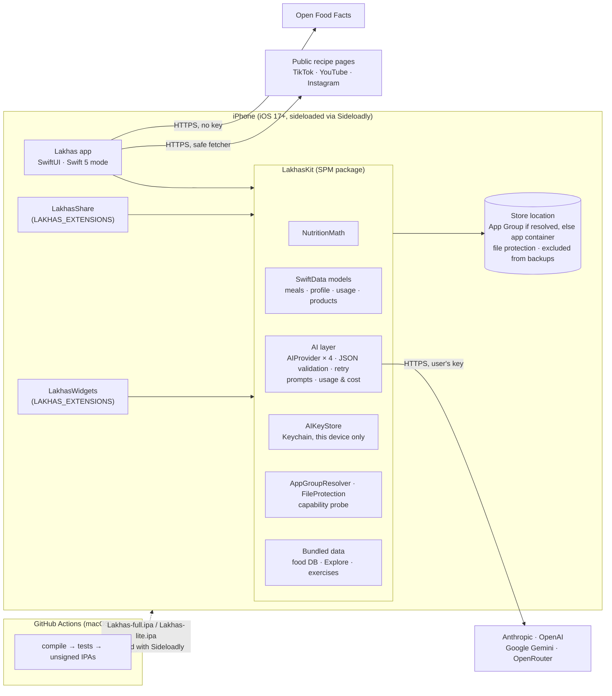

# لخّص (Lakhas) — Architecture

Status: **Bring Your Own Key, no server (ADR-020)** · Last updated: 2026-10-13

Everything runs on the iPhone. AI requests go **directly** from the app to the provider the user chose, with the user's own API key. All data stays on the device. Decisions are in [`decisions.md`](decisions.md); sideloading constraints in [`sideloading.md`](sideloading.md).

---

## 1. Component diagram

There is no backend. `/backend`, `/admin` and `/shared/frozen` are kept for reference only (ADR-020).

---

## 2. AI layer (LakhasKit/AI)

| Piece | Role |
|---|---|
| `AIProviderKind` | `anthropic`, `openai`, `gemini`, `openrouter`: display name, API base URL, key page URL, built-in model list, recommended **standard** and **accurate** models |
| `AIProvider` (protocol) | `complete(_ request: AIRequest, model:) async throws -> AIResponse` and `listModels()`. One implementation per provider, plain `URLSession` |
| `AIRequest` | system prompt, user text, JPEG images, the JSON schema of the expected answer, max output tokens |
| `AIResponse` | the raw JSON text, input/output token usage, the model used |
| `StructuredAI` | Builds the request, extracts JSON (tolerates code fences), decodes with `Codable`, runs `validate()`. On failure, **one retry** with the error appended. Records usage and the last request's diagnostic (`AIDiagnostic`, ADR-023). |
| `AIKeyStore` | One Keychain item per provider (`WhenUnlockedThisDeviceOnly`). Never logged; never in backups or exports |
| `AISettings` | provider, chosen standard/accurate model per provider, **High accuracy** toggle, optional daily limit (UserDefaults) |
| `UsageRecord` (SwiftData) + `PriceTable` | Per request: provider, model, feature, tokens, success, estimated cost. Prices are bundled defaults plus user overrides, always labeled "estimate" |

Structured output per provider:

| Provider | Endpoint | Structured output |
|---|---|---|
| Anthropic | `POST https://api.anthropic.com/v1/messages` (`x-api-key`, `anthropic-version: 2023-06-01`) | `output_config: {format: {type: "json_schema", schema}, effort: "low"}` |
| OpenAI | `POST https://api.openai.com/v1/chat/completions` (Bearer) | `response_format: {type: "json_schema", json_schema: {name, schema, strict: true}}` |
| Gemini | `POST https://generativelanguage.googleapis.com/v1beta/models/{model}:generateContent` (`x-goog-api-key`) | `responseMimeType: "application/json"` + `responseSchema` (OpenAPI subset: `nullable`, no `additionalProperties`); low thinking (`thinkingLevel`, or `thinkingBudget` on 2.5), resent without it if refused; if the schema is refused, retried with the schema in the prompt (ADR-023) |
| OpenRouter | `POST https://openrouter.ai/api/v1/chat/completions` (Bearer) | `response_format: json_schema`; if the model rejects it, retried without it (prompt-only JSON) |

Model routing: **photo analysis** uses the accurate model when High accuracy is on, otherwise the standard model. **Text, corrections, labels and recipes** always use the standard model.

---

## 3. Data on the device

SwiftData models (in LakhasKit): `UserProfile`, `GoalOverride`, `Meal`, `MealItem` (with `sortIndex`; to-many order is not preserved), `UsageRecord` and `Product` (barcode library, ADR-022). Later phases add saved meals, recipes, water, weight and workouts.

- **Location:** resolved by `AppGroupResolver` (ADR-014).
- **Protection:** every file gets `completeUntilFirstUserAuthentication` and is **excluded from device backups** (`isExcludedFromBackup`).
- **Photos:** meal, recipe and product photos are stored as files next to the store, with the same protection and exclusion. They are downscaled with metadata stripped before saving or sending.
- **Bundled read-only data (Phases 5, 8, 9):** `FoodDB.sqlite` (USDA subset + Arabic dishes, FTS5), `explore.json` + images, `exercises.json` + images.
- **Leaving the phone:** data leaves only through an export file the user creates (Phase 11). The API key is never included.

---

## 4. Flows

### 4.1 AI request (photo example, Phase 5)
1. Downscale to ≤ 1568 px and re-encode JPEG 0.8 without metadata.
2. **Dedupe:** if the same image (SHA-256) was analyzed today, reuse the cached result at no cost.
3. **Limits:** check the optional daily limit and that a key is set. With no key, show the "no key" screen.
4. **Call:** `StructuredAI` → provider → JSON → `Codable` + `validate()`, retrying once on failure.
5. **Post-process:** apply the DB override (§7 of the brief) and compute totals as grams × per-100g. Record usage with its cost estimate.

### 4.2 Barcode (ADR-022)
1. Scan with VisionKit (EAN-13, EAN-8, UPC-E) or type the number. `Barcode.normalize` gives one canonical code (UPC-A → EAN-13, check digit verified).
2. **Local products first**, then Open Food Facts (`GET /api/v2/product/{code}`, no key, only the fields we use).
3. Found: the user picks a serving, 100 g or grams, and the product goes to the review screen as one `product` line. Logging saves the product locally.
4. Not found, or found without nutrition values: two label photos (nutrition table + front) are read by the user's provider with the standard model (`label.v1`), or the user types the values. The user checks the form and saves; the product stays on this device.

### 4.3 No key
Every AI entry point checks `AIKeyStore` for the selected provider. If no key is set, it presents `NoKeyView`: what a key is, how to get one per provider, and a rough cost. It links to Settings → AI. There is no fallback.

---

## 5. Security summary

| Control | Implementation |
|---|---|
| Keys | Keychain only, `WhenUnlockedThisDeviceOnly`; masked in UI; deletable; never logged or exported |
| Transport | ATS, HTTPS only, system trust (no pinning) |
| Data at rest | File protection on every file; excluded from device backups; no cloud sync |
| Photos | Metadata stripped and downscaled before saving or sending |
| Untrusted input | AI output validated; recipe fetcher allow-lists hosts and caps size/redirects; page text passed as data |
| Privacy | No analytics; the privacy notes name the chosen AI provider as the recipient of analyzed photos and text |
