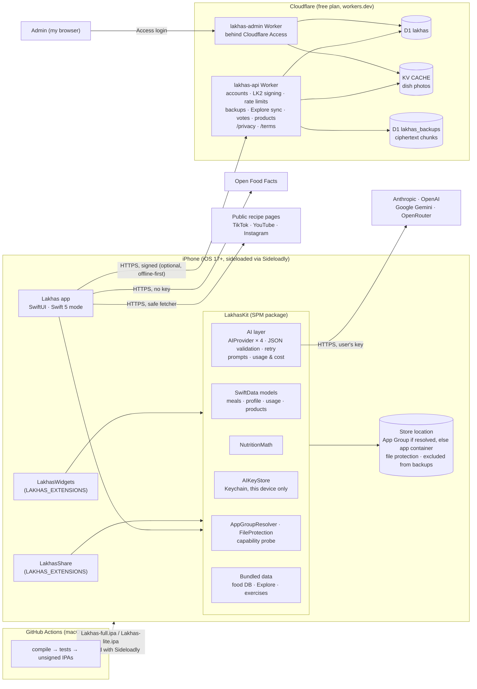

# لخّص (Lakhas) — Architecture

Status: **AI is Bring Your Own Key (ADR-020); small optional backend (ADR-027)** · Last updated: 2026-10-18

AI runs on the iPhone. Requests go **directly** from the app to the provider the user chose, with the user's own API key. Data lives on the device. A small Cloudflare backend (ADR-027) adds optional accounts, an end-to-end encrypted backup, Explore content, votes and shared products. It never calls an AI provider, and everything else works without it. Decisions are in [`decisions.md`](decisions.md); sideloading constraints in [`sideloading.md`](sideloading.md).

---

## 1. Component diagram



The backend lives in `/backend` (§6). `/admin` and `/shared/frozen` stay frozen for reference only.

---

## 2. AI layer (LakhasKit/AI)

| Piece | Role |
|---|---|
| `AIProviderKind` | `anthropic`, `openai`, `gemini`, `openrouter`: display name, API base URL, key page URL, built-in model list, recommended **standard** and **accurate** models |
| `AIProvider` (protocol) | `complete(_ request: AIRequest, model:) async throws -> AIResponse` and `listModels()`. One implementation per provider, plain `URLSession` |
| `AIRequest` | system prompt, user text, JPEG images, the JSON schema of the expected answer, max output tokens |
| `AIResponse` | the raw JSON text, input/output token usage, the model used |
| `StructuredAI` | Builds the request, extracts JSON (tolerates code fences), decodes with `Codable`, runs `validate()`. On failure, **one retry** with the error appended. Records usage and the last request's diagnostic (`AIDiagnostic`, ADR-023). |
| `AIKeyStore` | One Keychain item per provider (`WhenUnlockedThisDeviceOnly`). Never logged; never in backups or exports |
| `AISettings` | provider, chosen standard/accurate model per provider, **High accuracy** toggle, optional daily limit (UserDefaults) |
| `UsageRecord` (SwiftData) + `PriceTable` | Per request: provider, model, feature, tokens, success, estimated cost. Prices are bundled defaults plus user overrides, always labeled "estimate" |

Structured output per provider:

| Provider | Endpoint | Structured output |
|---|---|---|
| Anthropic | `POST https://api.anthropic.com/v1/messages` (`x-api-key`, `anthropic-version: 2023-06-01`) | `output_config: {format: {type: "json_schema", schema}, effort: "low"}` |
| OpenAI | `POST https://api.openai.com/v1/chat/completions` (Bearer) | `response_format: {type: "json_schema", json_schema: {name, schema, strict: true}}` |
| Gemini | `POST https://generativelanguage.googleapis.com/v1beta/models/{model}:generateContent` (`x-goog-api-key`) | `responseMimeType: "application/json"` + `responseSchema` (OpenAPI subset: `nullable`, no `additionalProperties`); low thinking (`thinkingLevel`, or `thinkingBudget` on 2.5), resent without it if refused; if the schema is refused, retried with the schema in the prompt (ADR-023) |
| OpenRouter | `POST https://openrouter.ai/api/v1/chat/completions` (Bearer) | `response_format: json_schema`; if the model rejects it, retried without it (prompt-only JSON) |

Model routing: **photo analysis** uses the accurate model when High accuracy is on, otherwise the standard model. **Text, corrections, labels and recipes** always use the standard model.

---

## 3. Data on the device

SwiftData models (in LakhasKit): `UserProfile`, `GoalOverride`, `Meal`, `MealItem` (with `sortIndex`; to-many order is not preserved), `UsageRecord`, `Product` (barcode library, ADR-022), `Recipe` + `RecipeIngredient` and `SavedMeal` + `SavedMealItem` (ADR-025), `DishPreference` (Explore favorite, own rating, own photo; ADR-026). Later phases add water, weight and workouts.

- **Location:** resolved by `AppGroupResolver` (ADR-014).
- **Protection:** every file gets `completeUntilFirstUserAuthentication` and is **excluded from device backups** (`isExcludedFromBackup`).
- **Photos:** meal, recipe and product photos are stored as files next to the store, with the same protection and exclusion. They are downscaled with metadata stripped before saving or sending.
- **Bundled read-only data (Phases 5, 8, 9):** `foods.json` (USDA subset + Arabic dishes, ADR-021), `Explore/dishes.json` (91 dishes built from the food DB, ADR-026; placeholder plates, no images), `exercises.json` + images (Phase 9).
- **Leaving the phone:** data leaves only through an export file the user creates, or as an end-to-end encrypted backup when signed in (§6). The API key and session credentials are never included.

---

## 4. Flows

### 4.1 AI request (photo example, Phase 5)
1. Downscale to ≤ 1568 px and re-encode JPEG 0.8 without metadata.
2. **Dedupe:** if the same image (SHA-256) was analyzed today, reuse the cached result at no cost.
3. **Limits:** check the optional daily limit and that a key is set. With no key, show the "no key" screen.
4. **Call:** `StructuredAI` → provider → JSON → `Codable` + `validate()`, retrying once on failure.
5. **Post-process:** apply the DB override (§7 of the brief) and compute totals as grams × per-100g. Record usage with its cost estimate.

### 4.2 Barcode (ADR-022)
1. Scan with VisionKit (EAN-13, EAN-8, UPC-E) or type the number. `Barcode.normalize` gives one canonical code (UPC-A → EAN-13, check digit verified).
2. **Local products first**, then Open Food Facts (`GET /api/v2/product/{code}`, no key, only the fields we use).
3. Found: the user picks a serving, 100 g or grams, and the product goes to the review screen as one `product` line. Logging saves the product locally.
4. Not found, or found without nutrition values: two label photos (nutrition table + front) are read by the user's provider with the standard model (`label.v1`), or the user types the values. The user checks the form and saves; the product stays on this device.

### 4.3 Recipes (ADR-025)
1. **Link:** `RecipeLink.parse` accepts TikTok, Instagram and YouTube links (also inside shared text). `RecipePageFetcher` reads oEmbed and meta tags on the phone: allow-listed HTTPS hosts, every redirect re-checked, 15 s / 30 s timeouts, 3 MB cap, no cookies.
2. **No usable text** (login wall, hashtags only): the app says so and offers **paste the caption** or **screenshots** (≤ 6, downscaled, no metadata).
3. **Extraction:** `RecipeImporter` → `AIService` (standard model, `recipe.v1`, page text as `<page_content>` data) → validated `RecipeExtraction` → `RecipeDraft`. A cost estimate is shown before, the real estimate is kept after.
4. **Recipe screen:** servings (scaling or sharing the same pot), grams and ingredients with live per-serving values. "Log one serving" logs each ingredient's share. Everything is saved on the device.
5. **Share extension:** copies the link with a `lakhas.shared-link` marker (and queues it when an App Group works). On open, the app offers "Import a recipe?" without reading the clipboard until the user accepts.

### 4.4 Explore (ADR-026)
1. `ExploreLibrary` loads the bundled dishes; the list filters by meal type and goal, searches names, aliases and ingredients (Arabic-normalized), and sorts by the profile goal, kcal, protein, favorites or my ratings (`DishPreference`).
2. The dish page edits a `RecipeDraft` (servings scale every amount, grams, ingredients from the food DB).
3. **Log to Today:** `ExploreLog.log` writes one `Meal` (source `explore`) with each ingredient's share for the chosen portions. No AI, no key.
4. **Save to My Recipes:** `ExploreLog.saveToRecipes` creates a `Recipe` with `exploreDishId`, shown under "From Explore".

### 4.5 No key
Every AI entry point checks `AIKeyStore` for the selected provider. If no key is set, it presents `NoKeyView`: what a key is, how to get one per provider, and a rough cost. It links to Settings → AI. There is no fallback.

---

## 6. Server (ADR-027)

Two Cloudflare Workers from `backend/`, on the free plan and `*.workers.dev`. They share the D1 database `lakhas` and the KV namespace `CACHE`; the API Worker also uses the D1 database `lakhas_backups` (Phase 10). No R2 (free plan without a card; budget and guards in ADR-027 §11). **No AI calls, no AI keys, no passwords, no backup plaintext on the server.**

| Worker | Host | Serves | Auth |
|---|---|---|---|
| `lakhas-api` | `lakhas-api.<sub>.workers.dev` | `/v1/*` app API, `/privacy`, `/terms`, `/health` | public: prelogin, sign up, sign in, Explore sync, media, pages; everything else: Bearer access token + LK2 signature |
| `lakhas-admin` | `lakhas-admin.<sub>.workers.dev` | admin panel (HTML) + `/api/*` | Cloudflare Access on the whole host + Access JWT verified in the Worker |

### 6.1 Keys (on the phone)
```
password ──PBKDF2-SHA256 (kdfSalt, 600k)──► stretched (never stored, never sent)
stretched ──HKDF(authSalt, "lakhas/auth/v1")──────► authKey ──► server stores HMAC(PEPPER, authKey)
stretched ──HKDF(encSalt,  "lakhas/backup-kek/v1")► passwordKEK ─┐
recovery code ──HKDF(recSalt, "lakhas/recovery-kek/v1")► recoveryKEK ─┤ wrap (AES-GCM)
recovery code ──HKDF(recSalt, "lakhas/recovery-auth/v1")► recoveryAuth ──► server stores HMAC(PEPPER, recoveryAuth)
random DEK (256-bit) ◄──────────────────────────────────────────────────┘ stored on the server only wrapped, twice
DEK ──AES-GCM, 512 KiB chunks──► backup ciphertext ──► D1 lakhas_backups (one row per chunk)
```
The phone keeps the DEK, the device secret and the tokens in the Keychain (this device only). None of them go into a backup.

### 6.2 D1 tables (schema v2, Phase 9 onward)
- `users`: id, email (unique, lowercased), `email_verified_at` (null for now), status (active/disabled), created_at, deleted_at.
- `identities`: user_id, provider (`password` now; `apple`/`google` later), subject, email, is_private_relay.
- `password_credentials`: user_id, kdf name and iterations, kdf/auth/enc salts, verifier.
- `key_envelopes`: user_id, kind (`password`, `recovery`; `passphrase` later), salt, wrapped DEK, nonce, version. Plus the recovery verifier.
- `devices`: id, user_id, label, encrypted device secret, status, created/last seen.
- `refresh_tokens`: hashed token, device, expiry, rotated_from. `request_nonces`: device, nonce, time.
- `invites`: code, expiry, use limit, uses.
- `backups` (in `lakhas_backups`): id, user_id, size, chunk count, complete, created_at; `backup_chunks`: backup_id, idx, data (BLOB ≤ 512 KiB).
- `daily_usage`: day, resource, count (KV write guard).
- `explore_dishes`, `explore_votes` (PK dish_id + user_id), `foods` (seeded from `foods.json`).
- `products` (approved / pending_review / rejected), `product_reports`.
- `abuse_events`, `admin_audit`.

### 6.3 Flows
1. **Sign up:**
   1. `prelogin` returns the salts.
   2. The phone derives the keys and creates the DEK and the recovery code.
   3. `POST /v1/auth/signup` sends the invite code, email, `authKey`, the envelopes and the recovery verifier.
   4. The server returns the device credential and tokens.
   5. The recovery code is shown once.
2. **Sign in:** `prelogin` → derive `authKey` → `POST /v1/auth/login` → device credential + tokens + the password envelope → unwrap the DEK on the phone.
3. **Refresh:** `POST /v1/auth/refresh` (signed) rotates the refresh token. Reusing an old one revokes the device.
4. **Backup (Phase 10):** export (no photos) → compress → encrypt 512 KiB chunks with the DEK → `POST /v1/backups` (size, chunk count) → `PUT /v1/backups/<id>/chunks/<n>` per chunk → complete. Retention: the last 3.
5. **Restore:** list backups → download → decrypt → replace the local store. Automatic after sign in on an empty phone.
6. **Recovery reset:**
   1. Prove `recoveryAuth` and get the recovery envelope.
   2. Unwrap the DEK and re-wrap it with the new password.
   3. Send the new verifier and envelopes. All sessions are revoked.
7. **Account deletion:** `DELETE /v1/account` (signed, with `authKey` or `recoveryAuth`) deletes the user rows, devices, sessions, envelopes, backups, votes (totals recounted) and pending products, then signs out.
8. **Explore sync (Phase 11):** `GET /v1/explore?since=` (public, ETag) overlays the bundled set. Votes go to `PUT /v1/explore/<id>/vote` (signed, one per account).
9. **Shared products (Phase 12):** `POST /v1/products` (signed) → review queue → approved products are found via `GET /v1/products/<barcode>`.

### 6.4 On the phone (LakhasKit/Server)
| Piece | Role |
|---|---|
| `AccountKeys` | PBKDF2-SHA256 (CommonCrypto) + HKDF split into `authKey` / `passwordKEK`, recovery code (base32, forgiving to type), AES-GCM key envelopes. Tested against `shared/test-vectors/account-keys.json` |
| `RequestSigner` | LK2 headers; tested against `shared/test-vectors/signing.json` |
| `SessionStore` | Session + backup data key in the Keychain (`lakhas.account`, `AfterFirstUnlockThisDeviceOnly`); memory under tests |
| `ServerClient` (actor) | JSON over an ephemeral URLSession (no cookies or cache, 20 s timeout). Signs requests, refreshes once on `session_expired` (one refresh at a time), signs out locally on `device_revoked` / `account_disabled` / `unauthorized` and posts `.lakhasSignedOut` |
| `AccountService` | Sign up (recovery code shown once), sign in, reset with the recovery code, change password, new recovery code, delete account. Key derivation runs off the main thread |
| `UITestingServer` | In-memory stand-in for the Worker under `-uiTesting` |

The app shows it all in Settings → Account (`Lakhas/Features/Account`). Sign-in is optional, and the rest of the app never waits on it.

### 6.5 Limits
Workers Rate Limiting per IP and per device (ADR-027 §6). The free-plan budget (10 ms CPU per request, D1 100k writes/day) is why the phone does the password stretching and why KV isn't used for counters.

---

## 7. Security summary

| Control | Implementation |
|---|---|
| Keys | Keychain only, `WhenUnlockedThisDeviceOnly`; masked in UI; deletable; never logged or exported |
| Transport | ATS, HTTPS only, system trust, no pinning (ADR-027 §8) |
| Server auth | Invite-only accounts; password stretched on the phone, only an HKDF `authKey` sent; peppered verifier; per-device secret with LK2 HMAC signing (timestamp + nonce); 15-min access + rotating refresh tokens; rate limits per IP and per device |
| Backup | AES-GCM on the phone with a random DEK, wrapped by the password KEK and the recovery KEK; the server can't derive either |
| Admin | Separate Worker behind Cloudflare Access + JWT check in the Worker; audited, CSRF-checked writes |
| Data at rest | File protection on every file; excluded from device backups; no cloud sync |
| Photos | Metadata stripped and downscaled before saving or sending |
| Untrusted input | AI output validated; recipe fetcher allow-lists hosts and caps size/redirects; page text passed as data |
| Privacy | No analytics; the privacy notes name the chosen AI provider as the recipient of analyzed photos and text |
